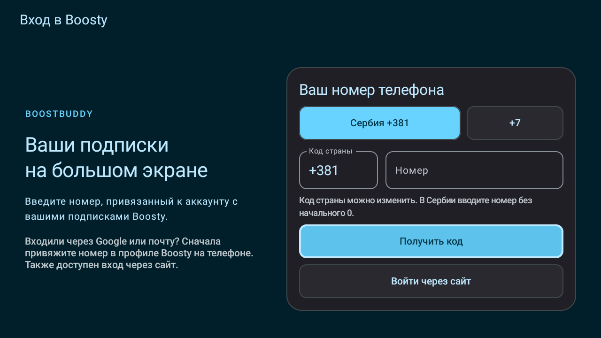
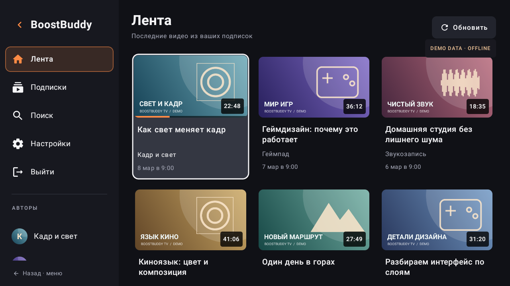
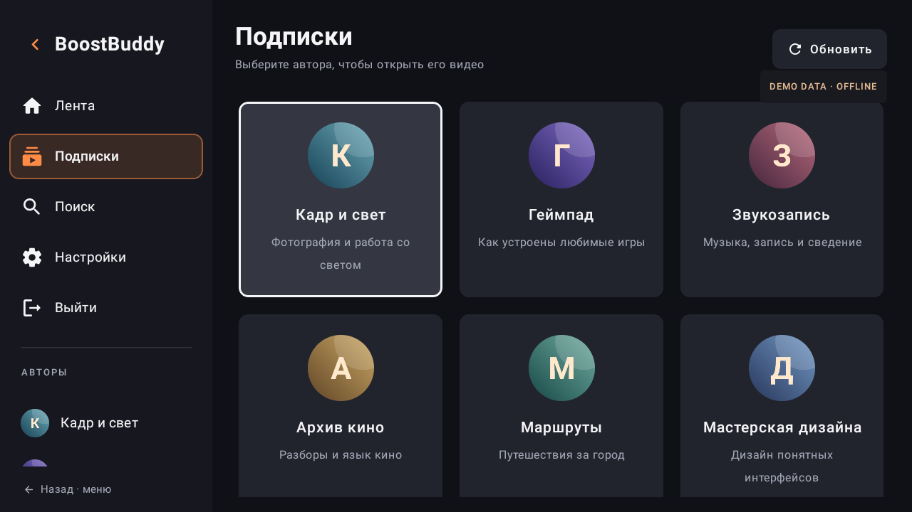

# BoostBuddy TV

A native Boosty client for **Google TV and Android TV**, built around a remote: browse your creators, find a video, and watch it in the native player.

[](https://github.com/fgsfds/BoostBuddy-TV/actions/workflows/build-tv.yml)

[**Download an APK**](https://github.com/fgsfds/BoostBuddy-TV/releases) · [Installation and build guide](README_TV.md) · [Validation](VALIDATION_TV.md) · [Code review](docs/CODE_REVIEW_TV.md)

An independent fork of [slartus/BoostBuddy](https://github.com/slartus/BoostBuddy), based on version **1.16.0**. This is an unofficial client; watching paid content requires access through your own Boosty account.

## Features

- **TV browsing:** collapsible sidebar, creator directory, video grid, search, and clear D-pad focus.
- **Native sign-in:** phone and verification-code forms, editable country code, resend cooldown, and an optional website fallback.
- **Complete subscription loading:** follows pagination beyond the first 30 entries and deduplicates creators.
- **Video cards:** artwork, duration, date, resume progress, and locked or processing states; multiple videos in one post become separate cards.
- **Native playback:** reuses BoostBuddy's Media3 player, quality selection, and resume support.
- **Separate installation:** the `ru.slartus.boostbuddy.tvfork` package can coexist with upstream BoostBuddy. Android **7.0 / API 24** or newer is required.

The interface is currently in Russian. **Лента** = Feed, **Подписки** = Subscriptions, **Поиск** = Search, **Настройки** = Settings.

### Latest improvements — 1.16.0-tv.2

The [code review](docs/CODE_REVIEW_TV.md) fixed inherited HTTPS-verification bypasses, session-refresh races, login retry after a temporary profile error, stale feed pagination, lost playback progress, and TV focus/search restoration. Credentials are validated before sign-in becomes active; logging out invalidates pending account requests. Playback now releases resources directly when the activity stops and retains its position and play/pause state for return.

## Screenshots

Actual, unedited captures from an Android TV emulator at **1280 × 720**. Click an image to view it at full size. [Capture details and reproduction steps](docs/screenshots/README.md).

### Native phone login

[](docs/screenshots/tv-login.png)

*The normal TV activity, with the phone-number field empty and the keyboard dismissed. No account sign-in or verification-code request was performed.*

### Video feed — offline demo data

[](docs/screenshots/tv-feed-demo.png)

*The app's real TV components rendered with fictional local videos and artwork. The visible “DEMO DATA · OFFLINE” label identifies the fixture; this is not a connected account or a playback test.*

### Subscriptions — offline demo data

[](docs/screenshots/tv-subscriptions-demo.png)

*The real creator-directory component using fictional local creators. “DEMO DATA · OFFLINE” remains visible; no live subscription data is shown.*

## Get an APK

1. Open [**Releases**](https://github.com/fgsfds/BoostBuddy-TV/releases) and choose a prerelease for the commit you want.
2. Under **Assets**, download the file ending in **`.apk`** directly. Public release downloads require no GitHub sign-in or artifact ZIP extraction. The same entry includes `SHA256SUMS`, `build-info.json`, and `INSTALL.txt`.
3. Transfer the downloaded APK to your TV and install it with an APK installer or `adb`. Launch **BoostBuddy TV**.

The [workflow](.github/workflows/build-tv.yml) builds and runs unit tests on **every branch push, pull request, and manual run**. Each successful branch-push or manual run on a branch publishes a new prerelease, tagged `ci-<run-id>-<publish-attempt>`, for the exact built commit. Pull requests produce Actions artifacts and reports without publishing a release.

Release assets are not subject to the **14-day** Actions artifact expiry, and the workflow does not automatically delete releases. [Actions APK artifacts and test reports](https://github.com/fgsfds/BoostBuddy-TV/actions/workflows/build-tv.yml) remain available for 14 days, subject to repository policy. See the [CI guide](README_TV.md#continuous-integration) for reruns and publication details.

**Signing and updates:** These prereleases contain **debug APKs**. Each fresh CI build uses an ephemeral debug key, so an APK from another build may require uninstalling the previous one, which removes local sign-in and settings. For stable in-place updates, use a persistent signing key you control; see [release signing](README_TV.md#release-signing). Publishing a prerelease does not change the Android app version or make it a Play Store release.

## Sign in

Use the phone number already linked to the Boosty account with your subscriptions. `+381` and `+7` are shortcuts; any supported country calling code can be entered explicitly. Choose **Получить код**, then enter the verification code.

Check messages in the Boosty app, a linked Telegram bot, or SMS: delivery is controlled by Boosty. If your account uses Google or email, first [link a phone number in your Boosty profile](https://boosty.to/boosty/posts/e2ca36ab-73ac-44b9-9890-660f9ebd7c3c), or choose **Войти через сайт** for the website fallback.

## Build locally

With **JDK 17**, Android SDK **35**, and Build Tools **35.x** configured:

```sh
./gradlew :composeApp:assembleDebug :composeApp:testDebugUnitTest
```

The APK is written to `composeApp/build/outputs/apk/debug/composeApp-debug.apk`. Use `gradlew.bat` on Windows. See [README_TV.md](README_TV.md) for SDK setup, signing, installation, and the implementation map. [AGENTS.md](AGENTS.md) contains shared project rules for contributors and coding tools; [docs/DEVELOPMENT.md](docs/DEVELOPMENT.md) covers screen, navigation, and API development.

## Validation and limits

The clean local build passed **84 automated tests**, including real loopback HTTPS checks and regressions for authentication, session races, paging, playback state, and TV focus. On an Android TV 10 emulator, the native login screen and offline browsing screens rendered successfully; remote navigation between cards, the sidebar, Subscriptions, and the search field was checked. [Full validation record](VALIDATION_TV.md).

**Live account sign-in, code delivery, token renewal against Boosty, and video playback have not been tested.** The screenshots demonstrate rendering and navigation with an empty login form or offline fixtures. Hardware playback and account access still need a device/account smoke test.

Boosty's unofficial API can change. The TV grid focuses on native Boosty video attachments; external embedded players and a dedicated livestream directory are outside this first implementation. The inherited iOS target has not been built or validated for this fork.

## License and origin

Licensed under [Apache 2.0](LICENSE). Original BoostBuddy copyright **2024 Artem Slinkin**. The [upstream README and dependency credits](docs/UPSTREAM_README.md) are preserved, and [TV_FORK_CHANGES.md](TV_FORK_CHANGES.md) records the fork's modifications.

The layout takes inspiration from SmartTube; no SmartTube source code or branding is included. Boosty and SmartTube are not affiliated with this fork.
